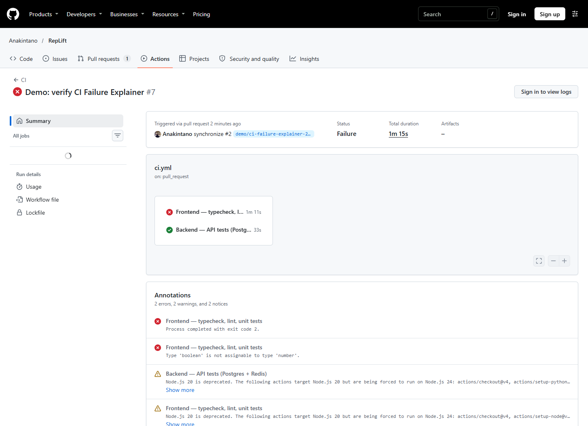
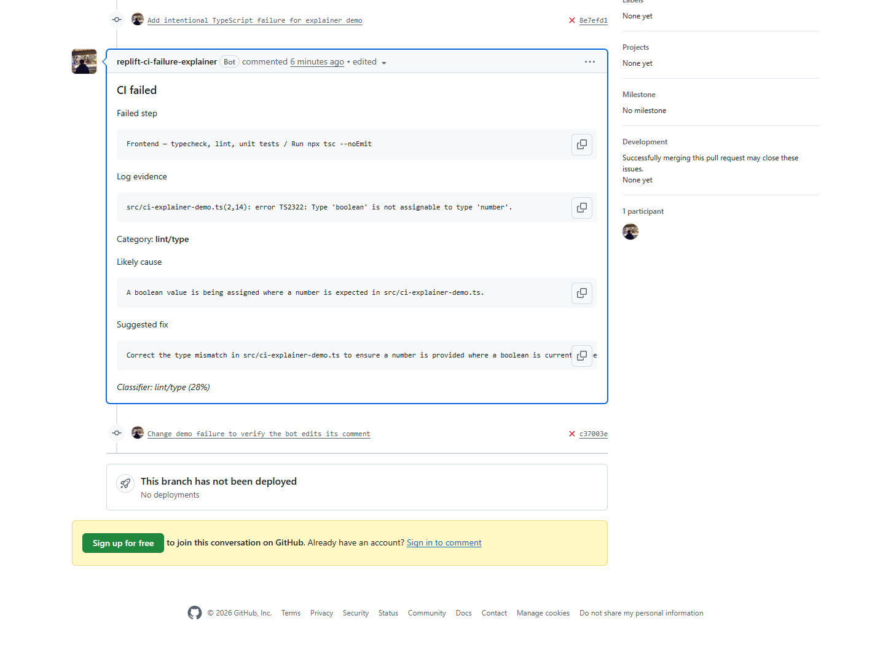
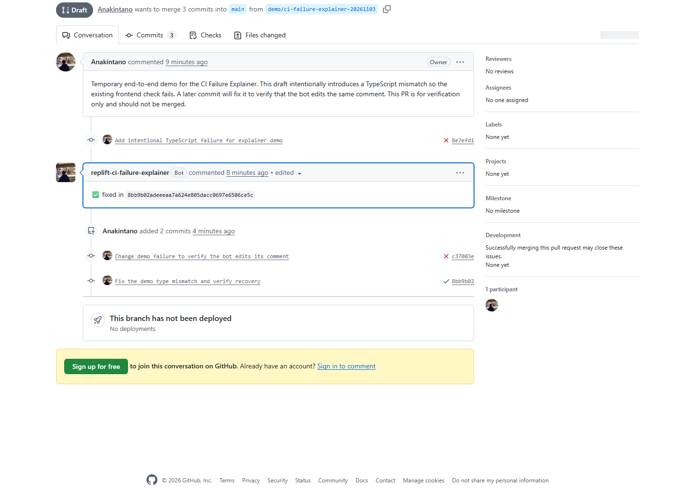

# Personal GitHub Action Bot

**A DevOps + AI capstone that turns failed CI checks into actionable PR feedback.**

Automated checks are great at telling you a pull request failed. They can leave you scrolling through thousands of lines to figure out why. This GitHub App reads the failed step, quotes the relevant error, and suggests a fix in one PR comment. When the same workflow passes, the comment is edited to show the fix commit.

## From red check to green

**PR opened or updated → CI runs → GitHub sends a webhook → bot explains the failure → developer pushes a fix → CI passes → same comment marked fixed**

The service verifies the webhook, downloads logs from failed jobs, and trims and redacts the output. YAML rules and a small TF-IDF + logistic regression classifier give NVIDIA Nemotron category hints. The app publishes a diagnosis only when the quoted line matches the processed log and meets the confidence threshold. SQLite tracks delivery recovery, duplicate runs, and the daily analysis limit.

## Live demo

On [RepLift PR #2](https://github.com/Anakintano/RepLift/pull/2), a deliberate TypeScript mismatch failed the frontend check. The bot quoted the real compiler error and updated the same comment after a passing run. The draft was closed without merging.

| Failed check | Bot diagnosis | Same comment after the fix |
| --- | --- | --- |
|  |  |  |

[Live Grafana dashboard](demo-screenshots/08-grafana-live.png) · [Webhook deliveries and retries](demo-screenshots/05-webhook-deliveries.png) · [Invalid signature rejected](demo-screenshots/06-signature-rejected.png) · [Bot declines to guess](demo-screenshots/07-unsure-comment.png) · [Green project pipeline](demo-screenshots/04-project-ci.png) · [Compose services running in CI](demo-screenshots/09-compose-services.png)

## DevOps stack

| Stage | Stack |
| --- | --- |
| Source and delivery | GitHub App and Actions, plus a Jenkins intake endpoint and Jenkinsfile |
| Service and local runtime | Python, FastAPI, SQLite, Docker and Compose |
| Local observability | Prometheus metrics and a Grafana dashboard in Docker Compose |
| Cloud deployment | Terraform, GKE Autopilot, Kubernetes, Artifact Registry, and GCS state |

The PR screenshots show the demo service before it loaded the classifier and comment formatting refinements. Monitoring was verified locally with Prometheus and Grafana scraping the service during two additional live RepLift failures. GitHub Actions separately verified that the three Compose services start together. Jenkins and GKE have yet to be verified live.

The classifier scored **73.3% (22/30)** on a synthetic holdout. See the [confusion matrix and setup guide](SETUP.md#classifier-evaluation) or the [GKE runbook](infra/README.md).

[MIT License](LICENSE)
